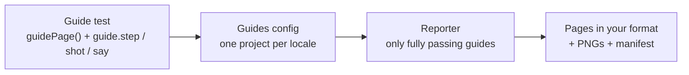

# e2g

Your e2e tests are your user guides. Write a flow once as a test, and get a numbered, illustrated, translated guide page that cannot go stale.

[](https://github.com/tailor-platform/e2g/actions/workflows/ci.yml)
[](LICENSE)
[](https://www.npmjs.com/package/@tailor-platform/e2g)


## Why

End-to-end tests and user guides describe the same thing: how a person gets something done in your app. Most teams keep them apart, so the tests stay green while the screenshots in the docs show last year's UI.

e2g makes them one artifact:

- **Docs that break when the UI breaks.** Steps come from the test, so a UI change that invalidates a guide fails CI instead of quietly shipping wrong docs.
- **Screenshots that maintain themselves.** Highlighted, cropped and masked shots are retaken on every docs run, and rewritten only when the screen really changed.
- **Every locale, checked by the compiler.** One test writes a page per locale, and a missing translation is a type error.
- **Free in your normal e2e run.** Without a guide locale the same test runs as a plain test: nothing is attached and no screenshot is taken.

## How it works



A guide is an ordinary Playwright test. Mark it with `guidePage()`, and use the `guide` fixture: wrap the steps you want to publish in `guide.step`, take screenshots with `guide.shot` and add paragraphs with `guide.say`. A separate guides config runs those tests once per locale, and a reporter turns each passing guide into a page and PNGs in your docs folder. Pages are only written from runs where the whole guide passed, so a broken or partial run never overwrites good docs.

## Contents

- [Example](#example)
- [Features](#features)
- [Quick start](#quick-start)
- [Retrofit an existing test](#retrofit-an-existing-test)
- [API](#api)
- [How writing works](#how-writing-works)
- [Recipes](#recipes)
- [Caveats](#caveats)
- [Contributing](#contributing)

## Example

### This test

```ts
// tests/invite.spec.ts
import { expect, guidePage, test } from "@tailor-platform/e2g/playwright";

const meta = {
  title: { en: "Invite a teammate", ja: "メンバーを招待する" },
  description: {
    en: "Add people to your workspace.",
    ja: "ワークスペースにメンバーを追加します。",
  },
};

test("invite by email", guidePage("invite-a-teammate", meta), async ({ page, guide }) => {
  await page.goto("/settings/members");
  await guide.say({
    en: "Admins can invite people from **Settings → Members**.",
    ja: "管理者は **設定 → メンバー** からメンバーを招待できます。",
  });

  await guide.step({ en: "Click **Invite**.", ja: "**招待** をクリックします。" }, async () => {
    const invite = page.getByTestId("invite-button");
    await guide.shot("invite-button", {
      alt: { en: "The Invite button", ja: "招待ボタン" },
      highlight: invite,
      crop: page.getByTestId("members-header"),
    });
    await invite.click();
  });

  await guide.step(
    {
      en: "Enter their email address and click **Send**.",
      ja: "メールアドレスを入力し、**送信** をクリックします。",
    },
    async () => {
      const dialog = page.getByRole("dialog");
      await dialog.getByRole("textbox").fill("sam@example.com");
      await guide.shot("invite-dialog", {
        alt: { en: "The invite dialog", ja: "招待のダイアログ" },
        crop: dialog,
      });
      await dialog.getByTestId("send-button").click();
    },
  );

  await guide.step(
    { en: "The invitation appears in the list.", ja: "招待した人が一覧に表示されます。" },
    async () => {
      await expect(page.getByTestId("member-row").last()).toContainText("sam@example.com");
    },
  );
});
```

### Writes this page

`docs/en/guides/invite-a-teammate.md` (and a `ja` page next to it), with the [output](#4-describe-the-output) from the quick start:

```md
---
title: Invite a teammate
description: Add people to your workspace.
---

<!-- Generated from tests/invite.spec.ts. Edit the test, not this page. -->

Admins can invite people from **Settings → Members**.

1. Click **Invite**.

   

2. Enter their email address and click **Send**.

   

3. The invitation appears in the list.
```

The two PNGs land in `docs/assets/guides/en/invite-a-teammate/`, the button outlined and the image cropped around the header.

## Features

- **Plain Playwright tests.** `guidePage()` returns the test's details (a tag and an annotation), and `guide` is a fixture, so a guide is a `test()` like any other, with your fixtures, hooks and page objects. Only `guide.step`s become numbered steps; `test.step`s and the steps of your page objects stay out of the page.
- **One test, every locale, checked by the compiler.** Each locale is a project with `use.guideLocale`. Register your locales once, and every step, paragraph and alt text must have all of them, or it is a type error. Playwright does not type-check your tests, so run `tsc --noEmit` in CI to catch a missing translation.
- **Any number of screenshots per step.** Each image sits under the instruction it illustrates, and in guide runs `guide.shot` fails if the elements it points at are not visible.
- **Highlight, crop, mask and hide.** Outline elements with CSS, crop to a region with padding that keeps the outline, mask sensitive values, leave out elements other tests created, and add CSS per shot.
- **A stable clock.** Guide runs freeze `Date.now()` before the first page opens in tests whose `test` comes from `guideTest` (directly or merged), so "5 minutes ago" and today's date do not change every image.
- **Reports point at your code.** A failing `guide.step` is reported at the line that called it, not inside this package.
- **Screenshot comparison that ignores rendering noise.** A new PNG that differs from the committed one only by anti-aliasing is not written, so reruns do not churn your git history.
- **Safe writes and pruning.** Pages come only from fully passing, full runs. Files are written atomically, and deletion is limited to files the reporter wrote before, as listed in a manifest.
- **Your format.** The reporter knows nothing about Markdown or front matter. You give it `path()` and `render()`; a small `blocksToMarkdown` helper covers the common case.
- **Free in normal runs.** Without `guideLocale`, `guide.step` is `test.step`, the clock runs, and `guide.say` and `guide.shot` attach nothing and touch no browser.

## Quick start

### 1. Install

```sh
npm i -D @tailor-platform/e2g yaml
```

Requires Node.js 22 or later and `@playwright/test` 1.64 or later as a peer dependency. The package is ESM only. `yaml` is only used by the output in step 4; use whatever you like there.

### 2. Register your locales

Declare your guide locales and the `meta` of a guide page in a declaration file:

```ts
// tests/guides.d.ts
import type { Text } from "@tailor-platform/e2g";

// your guide locales and the meta of a guide page, for every file tsconfig.json includes
declare module "@tailor-platform/e2g" {
  interface Register {
    locales: "en" | "ja";
    meta: { title: Text; description: Text };
  }
}
```

Put it where your `tsconfig.json` `include` covers it together with your specs and Playwright configs (for example `"include": ["tests", "*.ts"]`), so the configs see the locales too. It is never loaded at run time.

`Text` is what `guide.step`, `guide.say` and the `alt` of `guide.shot` take:

| Registered locales | `Text`                                                       |
| ------------------ | ------------------------------------------------------------ |
| two or more        | `Record<Locale, string>`: every locale, or a type error      |
| one                | `string`                                                     |
| none               | `string \| Record<string, string>`, checked only at run time |

Adding a locale to `Register` makes every text that lacks it a type error. That is intended: the compiler lists each translation the new locale still needs.

### 3. Get the `guide` fixture

If your tests use Playwright's `test` directly, import `test` and `expect` from this package instead, as the [test above](#this-test) does. It is Playwright's `test` with the `guide` fixture and the [options](#options) added.

If you already have a fixtures file, merge `guideTest` into your `test`:

```ts
// tests/fixtures.ts
import { mergeTests, test as base } from "@playwright/test";
import { guideTest } from "@tailor-platform/e2g/playwright";

// your own fixtures, as before
const app = base.extend<{ project: string }>({
  project: ["demo", { option: true }],
});

export const test = mergeTests(app, guideTest);
export { expect } from "@playwright/test";
```

Being a fixture is what lets `guide.step` and `guide.shot` find the test, the running step and the page without being passed them, lets guide runs freeze the clock before your `beforeEach` hooks open a page, and makes the [options](#options) typed fixture options that `test.use()` can set.

`guideTest` overrides the built-in `context` fixture to freeze the clock, and calls the `context` it overrides. If your fixtures override `context` the same way, `({ context }, use) => ...`, the order in `mergeTests` does not matter. If yours replaces it without asking for `context`, as with `launchPersistentContext`, put `guideTest` last, as above, so its override runs on your context; the other way round, the clock is not frozen.

### 4. Describe the output

`path()` says where a page goes and `render()` turns it into text. `page.locale` is one of your registered locales and `page.meta` is the value you gave `guidePage()`, typed by `Register`, with every locale in it, so the output picks the page's own.

```ts
// guides-output.ts
import { blocksToMarkdown } from "@tailor-platform/e2g/markdown";
import type { GuideOutput } from "@tailor-platform/e2g/playwright/reporter";
import { stringify } from "yaml";

export const output: GuideOutput = {
  path: (page) => `docs/${page.locale}/guides/${page.slug}.md`,
  render: (page, { image }) => {
    const frontMatter = {
      title: page.meta.title[page.locale],
      description: page.meta.description[page.locale],
    };
    return [
      `---\n${stringify(frontMatter)}---`,
      `<!-- Generated from tests/${page.source}. Edit the test, not this page. -->`,
      blocksToMarkdown(page.blocks, image),
    ].join("\n\n");
  },
};
```

### 5. Add a guides config

Guides are written by their own config: each locale project runs only the `@guide` tests (`grep: /@guide/`), with screenshots on. It should run against the same app, sign-in and browser settings as your e2e tests, so move what both configs share into a module:

```ts
// playwright.shared.ts
import { devices, type PlaywrightTestConfig } from "@playwright/test";

// settings both configs use, so guides run against the same app as your e2e tests
export const shared = {
  testDir: "tests",
  webServer: { command: "npm run dev", url: "http://localhost:3000", reuseExistingServer: true },
  use: { ...devices["Desktop Chrome"], baseURL: "http://localhost:3000" },
} satisfies PlaywrightTestConfig;

export const setup = { name: "setup", testMatch: /.*\.setup\.ts/ };

export const signedIn = { storageState: "playwright/.auth/admin.json" };
```

```ts
// tests/auth.setup.ts
import { test as setup } from "@playwright/test";
import { signedIn } from "../playwright.shared";

setup("sign in", async ({ page }) => {
  await page.goto("/sign-in?as=admin");
  await page.context().storageState({ path: signedIn.storageState });
});
```

Your e2e config uses it and runs the guides as plain tests; nothing guide-related goes in it:

```ts
// playwright.config.ts
import { defineConfig } from "@playwright/test";
import { setup, shared, signedIn } from "./playwright.shared";

export default defineConfig({
  ...shared,
  projects: [setup, { name: "chromium", dependencies: ["setup"], use: signedIn }],
});
```

The guides config adds the locale projects and the reporter. `defineConfig<GuideOptions>` checks `guideLocale` against your registered locales. `grep` goes on each locale project, not at the top level, where it would also filter out the setup project's tests:

```ts
// playwright.guides.config.ts
import { defineConfig } from "@playwright/test";
import type { GuideOptions } from "@tailor-platform/e2g/playwright";
import type { GuidesReporterOptions } from "@tailor-platform/e2g/playwright/reporter";
import { output } from "./guides-output";
import { setup, shared, signedIn } from "./playwright.shared";

const guides: GuidesReporterOptions = {
  output,
  shots: { dir: "docs/assets/guides" },
  manifest: "docs/.guides.json",
  prune: true,
};

export default defineConfig<GuideOptions>({
  ...shared,
  forbidOnly: true,
  reporter: [["list"], ["@tailor-platform/e2g/playwright/reporter", guides]],
  use: { ...shared.use, guideShots: true },
  projects: [
    // no grep here: the setup project runs its tests as usual
    setup,
    {
      name: "en",
      grep: /@guide/,
      dependencies: ["setup"],
      use: { ...signedIn, guideLocale: "en", locale: "en-US", timezoneId: "UTC" },
    },
    {
      name: "ja",
      grep: /@guide/,
      dependencies: ["setup"],
      use: { ...signedIn, guideLocale: "ja", locale: "ja-JP", timezoneId: "Asia/Tokyo" },
    },
  ],
});
```

### 6. Write a guide

Pass `guidePage(slug, meta)` as the test's details and take `guide` from the fixtures, as in [the example at the top](#this-test). Tests without `guidePage()` are never part of a page, and the guides config does not run them.

Each locale project runs the whole test, so it must pass in every locale. Find elements by test id, as above, or by your app's translation keys ([recipe](#locators-in-several-languages)), not by English text that the `ja` run will not find.

### 7. Run

The shared [`webServer`](https://playwright.dev/docs/test-webserver) starts your app, or reuses the one already running.

```sh
npx playwright test -c playwright.guides.config.ts
```

Commit the pages, the PNGs and `docs/.guides.json`.

## Retrofit an existing test

Keep the test, add `guidePage()` to its details, and turn the steps you want to publish into `guide.step`s with a `guide.shot`. Steps you leave as `test.step` still run but stay out of the page. Your fixtures file needs `guideTest` merged in, as in [step 3](#3-get-the-guide-fixture), and if your suite signs in through a setup project, the guides config depends on it, as in [step 5](#5-add-a-guides-config).

```diff
+import { guidePage } from "@tailor-platform/e2g/playwright";
 import { expect, test } from "./fixtures";
+
+const meta = {
+  title: { en: "Archive a project", ja: "プロジェクトをアーカイブする" },
+  description: { en: "Hide a project you no longer use.", ja: "使わないプロジェクトを隠します。" },
+};
+const details = guidePage("archive-project", meta, { tag: "@smoke" });

-test("archive a project", { tag: "@smoke" }, async ({ page, project }) => {
+test("archive a project", details, async ({ page, project, guide }) => {
   await page.goto(`/projects/${project}/settings`);
-  await test.step("open the danger zone", async () => {
+  await guide.step({ en: "Open **Danger zone**.", ja: "**危険な操作** を開きます。" }, async () => {
     await page.getByTestId("danger-zone").click();
+    await guide.shot("danger-zone", {
+      alt: { en: "The danger zone", ja: "危険な操作" },
+      highlight: page.getByTestId("archive-button"),
+    });
   });
   await test.step("confirm", async () => {
     await page.getByTestId("archive-button").click();
     await page.getByRole("dialog").getByTestId("confirm").click();
   });
   await expect(page.getByTestId("archived-badge")).toBeVisible();
 });
```

The page has one step, "Open **Danger zone**.", with its screenshot. The `@smoke` tag stays, and `guidePage()` adds `@guide` next to it.

With one locale, that is the whole change: titles stay plain strings and your locators keep working, since the guide runs in the language the test was written for. With several locales, every locale project runs the whole test, so locators that match visible text must find it in each language; switch them to test ids or translation keys before adding the second locale.

## API

### Exports

| Import                                     | Exports                                                                                                                                                                                                               |
| ------------------------------------------ | --------------------------------------------------------------------------------------------------------------------------------------------------------------------------------------------------------------------- |
| `@tailor-platform/e2g`                     | types only: `Register`, `Locale`, `Meta`, `Text`, `Page`, `Block`, `Shot`, `GuideOutput`                                                                                                                              |
| `@tailor-platform/e2g/markdown`            | `blocksToMarkdown`                                                                                                                                                                                                    |
| `@tailor-platform/e2g/playwright`          | `guideTest`, `test` (the same object), `expect` (Playwright's), `guidePage`; types `Guide`, `GuideStepDetails`, `GuideOptions`, `GuideShotSettings`, `ShotOptions`, `Locale`, `Meta`, `Text`, `Page`, `Block`, `Shot` |
| `@tailor-platform/e2g/playwright/reporter` | default `GuidesReporter`; types `GuidesReporterOptions`, `GuideOutput`, `Page`                                                                                                                                        |

The root and `@tailor-platform/e2g/markdown` do not load Playwright. `@playwright/test` is an optional peer dependency, needed only for `@tailor-platform/e2g/playwright`. `Register` is augmented on `@tailor-platform/e2g` itself.

### `Register`

An empty interface you augment with `declare module "@tailor-platform/e2g"`, as in [step 2](#2-register-your-locales). Both keys are optional.

| Type     | Registered                             | Not registered                     |
| -------- | -------------------------------------- | ---------------------------------- |
| `Locale` | `Register["locales"]`                  | `string`                           |
| `Meta`   | `Register["meta"]`                     | `unknown`                          |
| `Text`   | see [step 2](#2-register-your-locales) | `string \| Record<string, string>` |

### `guideTest`

Playwright's `test` extended with the `guide` fixture and the [options](#options). Use it as `test` directly, or merge it with `mergeTests` ([step 3](#3-get-the-guide-fixture)). `test` and `expect` are exported for projects that have no fixtures file.

It also overrides the `context` fixture, to [freeze the clock](#the-clock) in guide runs.

### `guidePage(slug, meta, details?)`

Returns `TestDetails` for `test(title, details, body)`. It keeps your `details`, adds the `@guide` tag to your `tag`s (once) and adds a `e2g` annotation with `{ slug, meta }` to your `annotation`s.

- `slug` names the page; with the default paths it is the file name.
- `meta` has the type you registered as `Register["meta"]` and must be a JSON value. The library never reads it: it reaches your output as `page.meta`, as is. Put every locale's values in it and pick the page's in `render`.

A page is one slug in one locale. It may be built from several tests in the same spec file; their steps are joined in source order, and their `meta` must be equal.

### The `guide` fixture

```ts
interface Guide {
  /** A numbered step of the guide page; shots taken in its body belong to it. */
  step<T>(title: Text, body: () => Promise<T>, details?: GuideStepDetails): Promise<T>;
  /** A paragraph of the guide page, between steps. */
  say(text: Text): Promise<void>;
  /** A screenshot of the page, shown under the running step. */
  shot(name: string, opts: ShotOptions): Promise<void>;
}
```

A `Text` that is a string is used as is. For a record, a guide run uses the project's `guideLocale` key and throws if it is missing (`guide.step() has no "ja" text`); a normal e2e run uses the record's first key, which only shows in reports.

The checks below throw in every run, guide or not, so a misuse fails your normal e2e suite too. Checks on a text's content apply to every locale in the record, not only the running one, so a broken translation fails any run. A `guide` kept and used after its test ended throws (`guide.step() must be called while its test runs`).

#### `guide.step(title, body, details?)`

Runs `body` in `test.step` and marks that step as a numbered step of the page. It returns what `body` returns.

- `title` is the text of one list item, so it must be a single line (`guide.step() title must be a single line`). Write longer text with `guide.say`.
- `guide.step` cannot be nested (`guide.step() cannot be called inside guide.step()`). A `test.step` inside it is fine, but it is not a step of its own. Steps that run side by side, as in `Promise.all`, are fine.
- Call it from the test or any helper the test calls, such as a page object. Calls from `beforeEach` and `afterEach` hooks count too, in the order they run.
- Do not call it from a fixture. Playwright drops the steps of a boxed fixture (`box: true`) from reports, so they vanish from the page. Steps in any other fixture are reported under that fixture's setup or teardown, not as the test's own steps, so where they land in the page depends on when Playwright sets the fixture up and tears it down.

`details` are passed to `test.step`:

```ts
interface GuideStepDetails {
  box?: boolean;
  timeout?: number;
  location?: Location;
}
```

The step's location in reports and in the trace is the line that called `guide.step`, also when the call is in one of your helpers, unless you pass `location`. `guide.say` is located the same way.

#### `guide.shot(name, opts)`

Records a screenshot for the running `guide.step` (`guide.shot() must be called inside guide.step()`); it must finish before the step does. A step may take any number of shots; they appear in the order they were taken.

`name` becomes the file name, so it may contain only letters, digits, `.`, `_` and `-` (not `..`), and must be unique within the test and within the page.

In a guides run, `guide.shot` waits for `highlight` and `crop` to be visible, so a guide whose UI changed fails as a test, and records the name and `alt`. The PNG itself is taken only when `guideShots` is on. In a normal e2e run, `guide.shot` only checks its arguments.

| Option           | Type                   | Default               | Meaning                                                                                                                                                                                                                                                            |
| ---------------- | ---------------------- | --------------------- | ------------------------------------------------------------------------------------------------------------------------------------------------------------------------------------------------------------------------------------------------------------------ |
| `alt`            | `Text`                 | required              | Alt text of the image.                                                                                                                                                                                                                                             |
| `page`           | `Page`                 | the test's `page`     | The page to shoot, such as a popup.                                                                                                                                                                                                                                |
| `highlight`      | `Locator \| Locator[]` | none                  | Elements to outline with `highlightStyle`.                                                                                                                                                                                                                         |
| `crop`           | `Locator`              | whole viewport        | Crop to this element and the highlighted ones, plus `padding`. Taken from the full page, so it may be off screen.                                                                                                                                                  |
| `mask`           | `Locator[]`            | none                  | Passed to Playwright's `mask`, for emails, tokens and other values that change.                                                                                                                                                                                    |
| `hide`           | `Locator[]`            | none                  | Left out of the shot with `display: none`, and the crop is measured without them. Each locator may match no element or several. For elements chosen by their content, such as rows other tests or earlier runs created; hide fixed parts of the page with `style`. |
| `style`          | `string`               | none                  | CSS added for this shot only, after `guideShot.style`.                                                                                                                                                                                                             |
| `highlightStyle` | `string`               | `guideShot.highlight` | CSS declarations for the highlight of this shot.                                                                                                                                                                                                                   |
| `padding`        | `number`               | `guideShot.padding`   | Space around the crop in CSS pixels.                                                                                                                                                                                                                               |

```ts
await guide.shot("plans", {
  alt: { en: "The plan picker", ja: "プランの選択" },
  highlight: [page.getByTestId("plan-pro"), page.getByTestId("plan-team")],
  crop: page.getByTestId("plans"),
  mask: [page.getByTestId("card-number")],
  hide: [page.getByRole("listitem").filter({ hasText: /^test-/ })],
  style: ".promo-banner { display: none; }",
  highlightStyle: "outline: 3px dashed #0a84ff; outline-offset: 2px",
  padding: 24,
});
```

#### `guide.say(text)`

Adds a paragraph. Step numbers continue across it, unless the text's first line starts with `#` (a Markdown heading), which restarts the numbering at 1. Await it.

- The text is inserted as Markdown. Leading and trailing blank lines and the common indentation are removed, so a template literal can be indented with your code.
- It cannot be called inside a `guide.step` (`guide.say() cannot be called inside guide.step()`), and the text must not be empty (`guide.say() needs some text`).
- It runs as a boxed `test.step` titled by the text's first line.

### Options

Set these in the guides config's top-level or project `use`, typed with `defineConfig<GuideOptions>()`. `guideLocale` belongs on a project, where the reporter reads it; the others can also be changed for a file or a `describe` with `test.use()`. A project's `guideShot` replaces the top-level one as a whole, as Playwright merges `use` one key deep.

```ts
interface GuideOptions {
  /** The locale this project writes guides in. Without it the guide calls only check their arguments. */
  guideLocale?: Locale;
  /** Whether shots take screenshots. */
  guideShots: boolean;
  guideShot: GuideShotSettings;
  /** Where the page clock is frozen in a guide run: `"fixed"` at the time the context is made, or `false` to leave it running. */
  guideClock: "fixed" | false | Date | number;
}
```

| Option        | Default   | Meaning                                                                                                                                                               |
| ------------- | --------- | --------------------------------------------------------------------------------------------------------------------------------------------------------------------- |
| `guideLocale` | none      | The locale this project runs and writes, one of your registered locales. Without it the run is a normal e2e run: nothing is attached. Two projects may not share one. |
| `guideShots`  | `false`   | Take the PNGs. Without them a page that has shots is not written.                                                                                                     |
| `guideShot`   | see below | How screenshots look. Keys you leave out keep their defaults.                                                                                                         |
| `guideClock`  | `"fixed"` | [The clock](#the-clock) in guide runs: frozen when the context is made, frozen at a `Date` or epoch milliseconds, or `false` to leave it running.                     |

`guideShot` keys:

| Key          | Default                                                            | Meaning                                                                                                                                                                                                                                                    |
| ------------ | ------------------------------------------------------------------ | ---------------------------------------------------------------------------------------------------------------------------------------------------------------------------------------------------------------------------------------------------------- |
| `highlight`  | `"outline:3px solid #e5484d;outline-offset:3px;border-radius:6px"` | CSS declarations applied to highlighted elements.                                                                                                                                                                                                          |
| `padding`    | `12`                                                               | Space around `crop` in CSS pixels. Highlighted elements are included in the crop, so the outline is not cut off.                                                                                                                                           |
| `style`      | `""`                                                               | CSS added to every shot, for app-specific fixes such as a custom caret.                                                                                                                                                                                    |
| `screenshot` | `{ animations: "disabled", caret: "hide" }`                        | Passed to `page.screenshot`, merged with the default: `scale`, `maskColor`, `omitBackground`, `timeout` and so on. `type` and `quality` are not accepted, since shots are PNG only; `path`, `clip`, `fullPage`, `style` and `mask` are set by the library. |

### The clock

In a guide run (a project with `guideLocale`), `guideTest` calls `context.clock.setFixedTime` as soon as Playwright creates the test's `context`, before any hook or test opens a page in it. `Date.now()` then stays put while timers keep running. This applies to every test whose `test` comes from `guideTest`, directly or through `mergeTests`, and that uses the built-in `context` or `page`, whether or not it asks for `guide`, and to every page of that context, popups included. A spec that imports `test` from `@playwright/test` keeps the real clock, as do normal e2e runs.

A context you create yourself with `browser.newContext()` is not frozen. To shoot a page of such a context with `guide.shot(name, { page })`, freeze it yourself with `page.clock.setFixedTime()` before it loads.

### The guides config

- **`grep: /@guide/` on each locale project**, exactly: no flags, not an array, no `grepInvert`. Any other `grep` may leave guides out, so the run is treated as partial and writes nothing. Only projects with `guideLocale` are checked, so a setup project needs no `grep`; a top-level `grep` would apply to it too and filter out its tests.
- **One project per locale**, each with its own `guideLocale`. Its other `use` options (`locale`, `timezoneId`, a browser) apply as usual. The pages expected are every `@guide` test's slug in every locale project.
- **`forbidOnly: true`**, required. A reporter cannot see `.only`, so without it the run is treated as partial and writes nothing (`wrote no guide pages because forbidOnly is off, so a .only run cannot be ruled out`).
- **Share the rest with your e2e config.** Reuse its `testDir`, `webServer`, `use` and setup projects (including `storageState`) so guides see the app your tests see.
- **Keep the reporter out of your normal config.** There it finds no project with `guideLocale` and writes nothing (`wrote no guide pages because no project sets use.guideLocale`). Your e2e config needs nothing from this library, and its reports stay free of screenshots.

### Reporter

```ts
reporter: [["list"], ["@tailor-platform/e2g/playwright/reporter", guides]],
```

| Option       | Type                                           | Default                                  | Meaning                                                                                                                                  |
| ------------ | ---------------------------------------------- | ---------------------------------------- | ---------------------------------------------------------------------------------------------------------------------------------------- |
| `output`     | `GuideOutput`                                  | required                                 | Where pages go and how they are rendered.                                                                                                |
| `shots.dir`  | `string`                                       | required                                 | Directory for screenshots.                                                                                                               |
| `shots.path` | `(page, name) => string`                       | `<shots.dir>/<locale>/<slug>/<name>.png` | Path of one screenshot.                                                                                                                  |
| `shots.same` | `((a: Buffer, b: Buffer) => boolean) \| false` | built-in comparison                      | Whether a new PNG shows the same screen as the file on disk, in which case the file is kept. `false` rewrites whenever the bytes differ. |
| `manifest`   | `string`                                       | required                                 | JSON file listing every file the reporter wrote. Commit it.                                                                              |
| `prune`      | `boolean`                                      | `false`                                  | Delete pages and shots that are in the manifest but were not produced by this run.                                                       |

Relative paths in the options and those returned by `output.path` and `shots.path` are resolved from the directory of the Playwright config file.

`output` is passed to the reporter as a live object, in the same process, so it can hold functions.

The reporter writes nothing to stdout. It logs to stderr, each line starting with `e2g: `. If it throws, for example because `render` throws, or a guide has an error such as a page split across spec files, it logs the error and marks the run failed.

```ts
const guides: GuidesReporterOptions = {
  output,
  shots: {
    dir: "docs/assets/guides",
    path: (page, name) => `docs/assets/guides/${page.slug}/${page.locale}-${name}.png`,
    same: false,
  },
  manifest: "docs/.guides.json",
  prune: true,
};
```

### `GuideOutput<M>` and `Page<M>`

```ts
interface GuideOutput<M = Meta> {
  path(page: Page<M>): string;
  render(page: Page<M>, ctx: { image(shot: { name: string }): string }): string;
}
```

```ts
interface Page<M = Meta> {
  slug: string;
  locale: Locale;
  meta: M;
  source: string;
  blocks: Block[];
}
```

```ts
type Block = { kind: "say"; text: string } | { kind: "step"; text: string; shots: Shot[] };
```

```ts
interface Shot {
  name: string;
  alt: string;
}
```

- `path(page)` returns the page's file path.
- `render(page, { image })` returns its content. `image(shot)` gives the shot's path relative to the page's directory, with `/` separators, ready for a link.
- `page.locale` is the project's `guideLocale`, and `page.meta` the `meta` given to `guidePage()`, untouched.
- `page.source` is the spec file relative to `config.rootDir` (the top-level `testDir`), with `/` separators.
- Step texts, paragraphs and `alt`s in `blocks` are already in the page's locale.

### `blocksToMarkdown(blocks, image)`

Renders blocks as CommonMark: each `step` becomes a numbered list item with its images indented under it in order, and each `say` a paragraph. Numbering continues across a `say` unless its first line starts with `#`, which restarts it at 1. Text is inserted as is, so inline Markdown works. Returns `""` for no blocks, otherwise text ending in a newline.

## How writing works

`guide.step` and `guide.say` attach a marker to their own step, and `guide.shot` attaches its name and `alt`, plus the PNG when `guideShots` is on. When a guide test ends, the reporter walks its last attempt's steps in start order, through hooks and helpers, and reads only those attachments: anything attached to the test directly is ignored. At the end of the run it groups the tests into pages and plans every write and delete before touching the disk.

| Situation                                                                                                           | Result                                                                                                                                                                                          |
| ------------------------------------------------------------------------------------------------------------------- | ----------------------------------------------------------------------------------------------------------------------------------------------------------------------------------------------- |
| The run may not include every guide ([signals](#partial-runs))                                                      | Nothing is written or deleted. One line says why.                                                                                                                                               |
| No project sets `guideLocale`                                                                                       | Nothing is written or deleted. One line says so.                                                                                                                                                |
| Two projects set the same `guideLocale`                                                                             | The run fails; nothing is written.                                                                                                                                                              |
| A page's tests span several spec files, their `meta` differ, a shot name repeats, or two pages map to the same file | The run fails; nothing is written or deleted. One line per error.                                                                                                                               |
| A test of the page failed, was skipped or did not run, or a guide attachment could not be read                      | That page and its shots are not written, and one line names it. Other pages are.                                                                                                                |
| A step's shot has no image, as when `guideShots` is off                                                             | That page and its shots are not written. One line says to run with `guideShots` on.                                                                                                             |
| A locale project ran none of the guide's tests, as with `--project en`                                              | That locale's page is not written. The other locales' pages are.                                                                                                                                |
| Every test of the page passed, including on retry (the last attempt counts)                                         | The page and its shots are written, and their paths added to the manifest.                                                                                                                      |
| A page's text or a PNG's bytes did not change, or the PNG only differs by rendering noise                           | That file is left as it is.                                                                                                                                                                     |
| `prune` is on and every page was written                                                                            | Files in the manifest that this run did not produce are deleted, along with directories left empty under `shots.dir` or the manifest's directory. The manifest is replaced by this run's files. |
| `prune` is on but a page was not written, or no guide was found                                                     | Nothing is deleted. One line says why.                                                                                                                                                          |
| `prune` is off                                                                                                      | Nothing is deleted. The manifest only gains entries.                                                                                                                                            |
| The manifest exists but is not valid JSON or not version 1                                                          | The manifest is left as it is and nothing is deleted. Pages are still written, but not recorded. One line says to fix or delete it.                                                             |

The manifest is the only list of files the reporter may delete, so hand-written pages next to generated ones are safe. Its paths are relative to the manifest's directory and use `/` on every OS. With only the invite guide, it reads:

<!-- prettier-ignore -->
```json
{
  "schemaVersion": 1,
  "pages": [
    "en/guides/invite-a-teammate.md",
    "ja/guides/invite-a-teammate.md"
  ],
  "shots": [
    "assets/guides/en/invite-a-teammate/invite-button.png",
    "assets/guides/en/invite-a-teammate/invite-dialog.png",
    "assets/guides/ja/invite-a-teammate/invite-button.png",
    "assets/guides/ja/invite-a-teammate/invite-dialog.png"
  ]
}
```

Writes happen in this order: the manifest gains every file about to be written, then stale files are deleted, then shots are written, then pages, then the final manifest. Each file is written to a temporary file and renamed into place. A run that crashes part way leaves each file either old or new, never half written, and every new file listed in the manifest.

### Partial runs

The reporter writes nothing when the run may not include every guide:

| Signal                                              | Example                                                                         |
| --------------------------------------------------- | ------------------------------------------------------------------------------- |
| Sharding                                            | `--shard 1/2`                                                                   |
| Repeats                                             | `--repeat-each 3`                                                               |
| UI mode or an editor extension (the test server)    | `--ui`, VS Code                                                                 |
| Not started by `playwright test`                    | a programmatic run                                                              |
| The run may stop early                              | `-x`, `--max-failures`, `maxFailures` in config                                 |
| A test filter option on the command line            | `-g`, `--grep-invert`, `--last-failed`, `--only-changed`, `--test-list`         |
| A file or location filter on the command line       | `tests/invite.spec.ts`, `invite`, `invite.spec.ts:12`, `-2` (a negative number) |
| Debugging or listing                                | `--debug`, `--list`                                                             |
| A locale project's `grep` is not exactly `/@guide/` | `grep: /@guide/i`, `grep: /@smoke/`, `grepInvert`                               |
| An error outside the tests                          | a spec file that fails to load                                                  |
| `forbidOnly` is not `true`                          | `forbidOnly: !!process.env.CI`, run locally                                     |

`--project` is not a partial run: the selected locales' pages are written, and the others' are not written and block `prune`, as in the table above.

## Recipes

### Keep shots stable

A shot is rewritten only when the screen changed, so anything that differs between runs shows up as a changed image. Remove each source of change at its root:

| What changes between runs                                            | What to do                                                                                                                         |
| -------------------------------------------------------------------- | ---------------------------------------------------------------------------------------------------------------------------------- |
| Today's date, times, "5 minutes ago"                                 | Keep [the clock](#the-clock) frozen, or [freeze it at a date](#freeze-the-clock-at-a-date). If it must run, `mask` the dates.      |
| Values a test must make unique, such as IDs                          | Keep the rest of the test data fixed, and `mask` only the unique values.                                                           |
| Data other tests or earlier runs created                             | `hide` it with a locator that picks it by content. Locale projects that run in parallel against one backend see each other's data. |
| Fixed parts of the page that come and go, such as toasts and banners | Hide them for every shot with `guideShot.style`.                                                                                   |
| Animations and the text caret                                        | Off by default (`animations: "disabled"`, `caret: "hide"`); [hide an editor's own caret](#hide-an-editors-caret) with `style`.     |
| Fonts and anti-aliasing between machines                             | Take shots in one image: [stable rendering with Docker](#stable-rendering-with-docker).                                            |
| Rendering noise too small to see                                     | Already ignored by the built-in comparison (`shots.same`).                                                                         |

`mask` keeps the element's box and paints over it, so use it when the place should stay and only the value changes. `hide` removes the element, and the ones after it move up, so use it when the element should not be there at all.

### A docs job in CI

Run the guides in a separate job and fail when the committed docs are out of date, including pages and shots that git does not track yet. Replace the last step with a commit or a pull request if you prefer the job to update them.

```yaml
docs:
  runs-on: ubuntu-latest
  container: mcr.microsoft.com/playwright:v1.64.1-noble
  steps:
    - uses: actions/checkout@v7
    - run: npm ci
    - run: npx playwright test -c playwright.guides.config.ts
    - run: git config --global --add safe.directory "$GITHUB_WORKSPACE"
    - run: test -z "$(git status --porcelain -- docs)"
```

### Stable rendering with Docker

Fonts and anti-aliasing differ between macOS, Windows and Linux. Take the screenshots in the official Playwright image, locally and in CI, so a rerun on another machine does not rewrite every PNG:

```sh
docker run --rm --ipc=host -v "$PWD":/work -v /work/node_modules -w /work \
  mcr.microsoft.com/playwright:v1.64.1-noble \
  sh -c "npm ci && npx playwright test -c playwright.guides.config.ts"
```

The anonymous `/work/node_modules` volume keeps the container's Linux install separate from yours.

### Steps in a page object

`guide.step` and `guide.shot` work from any function the test calls. Pass the `guide` along, and a shared helper documents itself wherever it is used:

```ts
export async function openBilling(page: Page, guide: Guide) {
  await guide.step({ en: "Open **Billing**.", ja: "**請求** を開きます。" }, async () => {
    await page.getByTestId("nav-billing").click();
    await guide.shot("billing", { alt: { en: "Billing", ja: "請求" } });
  });
}
```

Its shot name must still be unique within each page that uses it.

### Several shots in one step

```ts
await guide.step({ en: "Click **Continue**.", ja: "**続ける** をクリックします。" }, async () => {
  await guide.shot("continue", {
    alt: { en: "The Continue button", ja: "続けるボタン" },
    highlight: page.getByTestId("continue"),
  });
  await page.getByTestId("continue").click();
  await guide.shot("confirm", {
    alt: { en: "The confirmation", ja: "確認の画面" },
    crop: page.getByRole("dialog"),
  });
  await expect(page.getByRole("dialog")).toBeVisible();
});
```

### A paragraph over several lines

```ts
await guide.say({
  en: `
    Plans are billed monthly.
    You can change plans at any time.
  `,
  ja: `
    料金は月ごとに請求されます。
    プランはいつでも変えられます。
  `,
});
```

### Locators in several languages

Take `guideLocale` from the fixtures and look texts up the way your app does, here with a stand-in `i18n(locale)` that returns a `t(key)`. Normal e2e runs have no `guideLocale`, so fall back to the locale they run in:

```ts
const t = i18n(guideLocale ?? "en");
await guide.step({ en: "Click **Save**.", ja: "**保存** をクリックします。" }, async () => {
  await page.getByRole("button", { name: t("plans.save") }).click();
});
```

### Shoot a popup, with a longer timeout

`page` picks the page to shoot, and the third argument of `guide.step` takes the options of `test.step`:

```ts
await guide.step(
  { en: "Open the receipt.", ja: "領収書を開きます。" },
  async () => {
    const popup = page.waitForEvent("popup");
    await page.getByTestId("receipt").click();
    await guide.shot("receipt", {
      alt: { en: "The receipt", ja: "領収書" },
      page: await popup,
    });
  },
  { timeout: 30_000 },
);
```

### Freeze the clock at a date

When the UI shows today's date, fix it so the images do not change every day. In a spec file, or in the guides config's `use`:

```ts
test.use({ guideClock: new Date("2026-01-15T09:00:00Z") });
```

### Hide an editor's caret

`caret: "hide"` hides the browser's text caret, but code editors draw their own. Hide it with `guideShot.style`:

```ts
guideShot: {
  style: ".cm-cursor { display: none; }",
},
```

## Caveats

- **Test titles stay in one language.** They are evaluated at collection time, before a locale is known. Put localized titles in `meta`.
- **`guide` opens a page.** It depends on the `page` fixture, so a test that asks for `guide` always gets a page, even if it only calls `guide.say`.
- **Keep `output` imports light.** Workers load the config file too, so whatever `guides-output.ts` imports is loaded by every worker. Avoid importing a docs site build or a Markdown toolchain there.
- **Attachments reach other reporters.** Shots are ordinary step attachments, so an html or blob reporter in the guides config stores them too. Your normal config attaches nothing.
- **`.only` cannot be detected by a reporter.** A `.only` makes the guides outside it look absent, so the guides config requires `forbidOnly: true`.
- **A caught error does not remove a step.** If the test catches an error thrown inside a `guide.step` and still passes, that step stays in the page.
- **PNG only.** Screenshots are compared pixel by pixel to ignore rendering noise, which lossy formats would defeat. `type` and `quality` cannot be set.
- **No sharding or merged reports.** A sharded run is partial and writes nothing; generate the docs in a single run.

## Contributing

```sh
pnpm install
pnpm exec playwright install chromium
pnpm lint            # oxlint and oxfmt
pnpm typecheck       # includes the README examples in test/readme
pnpm test            # unit tests, README checks and reporter end-to-end tests
pnpm test:browser    # the guide fixture in a real browser
pnpm build && pnpm check:pkg
```

Add a changeset with `pnpm changeset` to any PR that changes the published package. Merging to main opens a release PR; merging that publishes to npm.

## License

[MIT](./LICENSE)
